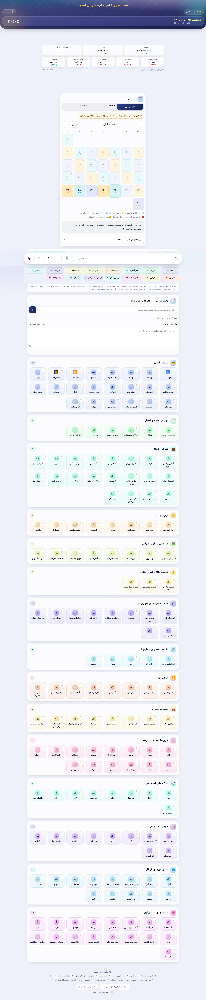

# میز کار علی رأفتی

میزکار شخصی تک‌فایله: لینک‌های سریع، تقویم و شیفت کاری، اوقات شرعی و آب‌وهوای مشهد، قیمت لحظه‌ای بازار (طلا، ارز، بورس، رمز).

## اجرا

هیچ نصب و سروری لازم نیست — فقط فایل‌ها را همین‌طور که هستند روی هر هاست استاتیکی (مثل GitHub Pages) بگذارید یا `index.html` را مستقیم در مرورگر باز کنید.

## شخصی‌سازی کاشی‌ها و دسته‌ها

- دکمهٔ **✎** نوار بالا (یا کلید `e`) «حالت ویرایش» را روشن می‌کند؛ یک گزینهٔ مجزا مثل دکمهٔ ＋ افزودن لینک.
- در حالت ویرایش: هر کاشی را **بکش و رها کن** تا جابه‌جا شود؛ دسته‌ها را با دستگیرهٔ **⠿** کنار عنوان جابه‌جا کن و با **✎** کنار شمارنده، نام هر دسته را عوض کن. ترتیب و نام‌ها روی همان دستگاه ذخیره می‌شوند (و در پشتیبان‌گیری هم می‌آیند).
- دکمه‌های حذف (×) فقط در حالت ویرایش دیده می‌شوند تا همیشه جلوی چشم نباشند.
- در حالت عادی، **نگه‌داشتن انگشت روی هر کاشی** (یا کلیک راست در کامپیوتر) منوی «سنجاق / ویرایش / حذف / جابه‌جایی» را باز می‌کند.
- حذف هر لینک اول **پنجرهٔ تأیید** دارد و بعد از حذف، توستِ **«برگردان»** می‌آید؛ لینک‌های حذف‌شده با دکمهٔ ↺ پایین صفحه هم برمی‌گردند.
- دکمهٔ «بازنشانی ترتیب» در نوار حالت ویرایش، ترتیب پیش‌فرض را برمی‌گرداند.

## موقعیت مکانی (اوقات شرعی، قبله، آب‌وهوا)

- پیش‌فرض مشهد است؛ با دکمهٔ «📍 موقعیت من» موقعیت خودت جایگزین می‌شود و با چیپ کنارش به مشهد برمی‌گردی.
- اگر مرورگر اجازهٔ GPS نداد یا فایل محلی باز شده باشد، برنامه خودکار با **موقعیت تقریبی اینترنت (IP)** ادامه می‌دهد؛ دقتش حدود یک شهر است و روی چیپ به‌صورت «موقعیت اینترنت شما» مشخص می‌شود.

## قیمت‌ها

هر عدد از منبع تخصصی همان بازار می‌آید و اگر منبع در دسترس نبود، به‌سرعت از جایگزین داخلی خوانده می‌شود:

- بیت‌کوین: CoinGecko ← بایننس ← tgju ← نوبیتکس. (کوین‌مارکت‌کپ API عمومیِ بدون کلید ندارد؛ برای فایل مستقل منابع رایگانِ بدون کلید انتخاب شده‌اند که همان قیمت را می‌دهند.)
- طلا و دلار: tgju ← طلاسی/میلی و نوبیتکس؛ انس و نقره: tgju ← Gold-API؛ شاخص بورس: TSETMC.

## سرعت

- سرویس‌ورکر نسخهٔ ۱۲: باز شدن برنامه از کش به‌صورت آنی (stale-while-revalidate) و به‌روزرسانی بی‌صدا در پس‌زمینه؛ اگر نسخهٔ تازه‌ای رسید، یک نوار کوچک بالای توست‌ها خبر می‌دهد.
- بخش‌های پایین صفحه تا رسیدن اسکرول رندر نمی‌شوند (`content-visibility`)؛ در حالت ویرایش همه‌چیز رندر می‌شود تا جابه‌جایی کاشی با پرش چیدمان همراه نباشد.
- آیکون سایت‌ها زودتر از قبل شروع می‌شوند و فقط بعد از لود موفق به صفحه اضافه می‌شوند؛ اتصال به سرورهای قیمت هم از قبل گرم می‌شود (preconnect).

## ساختار فایل‌ها

| فایل | نقش |
| --- | --- |
| `index.html` | کل برنامه (HTML + CSS + JS در یک فایل) |
| `manifest.webmanifest` | شناسنامهٔ PWA (نام، آیکون، رنگ) |
| `sw.js` | سرویس‌ورکر — کار آفلاین، لود آنی از کش و اطلاع نسخهٔ جدید |
| `icon-192.png` / `icon-512.png` | آیکون برنامه |
| `icon-maskable-512.png` | آیکون ماسک‌پذیر اندروید |
| `apple-touch-icon.png` | آیکون آیفون/آیپد |

## انتشار با GitHub Pages

1. ریپو را **Public** بسازید.
2. همهٔ فایل‌ها را در ریشهٔ ریپو آپلود کنید.
3. `Settings → Pages → Deploy from a branch → main / (root)` و Save.
4. آدرس: `https://USERNAME.github.io/REPO-NAME/`

نکته: سرویس‌ورکر و نصب به‌عنوان اپ (PWA) فقط زیر HTTPS کار می‌کند؛ GitHub Pages به‌صورت خودکار HTTPS دارد. همهٔ مسیرهای داخل فایل‌ها نسبی هستند، پس زیرپوشه هم مشکلی ایجاد نمی‌کند.

## داده‌ها

داده‌ها (لینک‌ها، یادداشت‌ها، ترتیب کاشی‌ها و تنظیمات) در `localStorage` همان مرورگر ذخیره می‌شوند؛ بین دستگاه‌ها هم‌گام نمی‌شوند و روی گیت‌هاب هم ذخیره نمی‌شوند.
